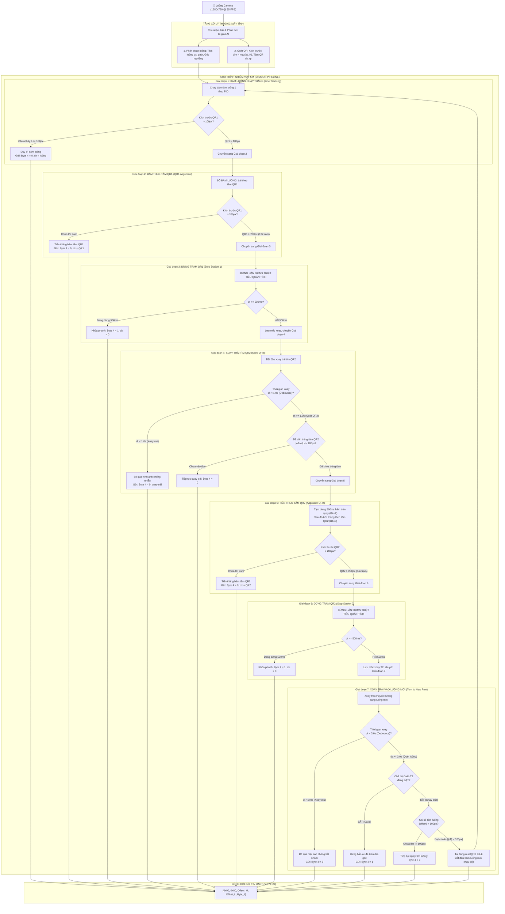

# TÀI LIỆU KIẾN TRÚC PHẦN MỀM & MÔ TẢ CHI TIẾT CÁC NHIỆM VỤ (TASKS) CỦA ROBOT AGV NÔNG NGHIỆP

---

## 1. TỔNG QUAN HỆ THỐNG PHẦN MỀM (SOFTWARE OVERVIEW)

Hệ thống phần mềm trên máy tính nhúng (Raspberry Pi 5) đảm nhiệm vai trò là bộ não thị giác máy tính và máy trạng thái điều phối cấp cao (High-Level Perception & Mission Controller). Hệ thống vận hành theo vòng lặp thời gian thực từ 30 – 40 FPS với 4 phân tầng kiến trúc:

1. **Perception Layer (Tầng Thị giác):**
   * **Path Detection (`src/path_detector.py` / `src/yolo_segmenter.py`):** Sử dụng mô hình `YOLO-FastestV2 NCNN INT8` phân đoạn luống bạt (màu đen/xanh), xác định Bounding Box, điểm tâm luống $C_{\text{path}}(x, y)$, đường tim (Centerline) và độ lệch ngang $\text{dx}_{\text{path}} = x_{\text{path}} - x_{\text{cam}}$.
   * **QR Checkpoint & Sizing (`qr_scanner/detector.py`):** Phát hiện, giải mã nội dung (`TURN_1`, `TURN_2`) và đo đạc kích thước thực tế theo pixel $(\text{width} \times \text{height})$, tâm QR $C_{\text{qr}}(x, y)$.

2. **Navigation Fusion Layer (Tầng Hợp nhất Dẫn hướng - `fuse_navigation_target`):**
   * Quyết định mục tiêu lái dựa trên kích thước QR:
     * Bình thường: Bám theo tâm luống (`PATH_LINE`).
     * Khi QR đạt kích thước $> 100 \times 100\text{ px}$: Tự động ngắt bám luống, chuyển sang bám thẳng theo tâm mã QR (`QR_CENTER`).

3. **Mission State Machine Layer (Máy trạng thái Nhiệm vụ - `QRTurnMissionManager`):**
   * Quản lý chu trình chuyển hướng tự động giữa các luống qua chuỗi nhiệm vụ khép kín từ Luống 1 sang Luống 2.

4. **Communication Layer (Tầng Đóng gói & Truyền thông UART - `uart_controller.py`):**
   * Đóng gói gói tin 5 Bytes gửi xuống vi điều khiển STM32 với chu kỳ 25 – 33ms qua cổng serial `/dev/ttySTM32`.

---

## 2. LƯU ĐỒ GIẢI THUẬT CÁC NHIỆM VỤ (MISSION FLOWCHART)

---

## 3. MÔ TẢ CHI TIẾT 7 GIAI ĐOẠN VẬN HÀNH

### 📌 Giai đoạn 1: Bám luống chạy thẳng (Line Tracking)
* **Ý nghĩa:** Trạng thái thường trực ban đầu khi robot làm việc trong luống cây.
* **Hành vi chuyển động:** Xe di chuyển tịnh tiến thẳng theo tim luống bằng thuật toán điều khiển PID.
* **Tín hiệu gửi đi:** `Byte 4 = 0`, `offset = dx_luống`.
* **Điều kiện chuyển tiếp:** Khi camera phát hiện mã `QR1` có kích thước:
  $$\text{dim}_{\text{QR1}} = \max(\text{width}, \text{height}) > 100\text{ px}$$
  $\to$ Tự động chuyển sang **Giai đoạn 2**.

---

### 📌 Giai đoạn 2: Bám theo tâm mã QR1 (QR1 Alignment)
* **Ý nghĩa:** Căn thẳng hướng mũi xe vào đúng tâm trạm dừng `QR1` trước khi kết thúc luống.
* **Hành vi chuyển động:** **Ngắt hoàn toàn chế độ bám luống**, chuyển điểm mục tiêu sang tâm mã `QR1`. Xe tự động bẻ lái căn giữa theo tâm mã `QR1`.
* **Tín hiệu gửi đi:** `Byte 4 = 0`, `offset = x_qr1 - x_cam`.
* **Điều kiện chuyển tiếp:** Khi xe tiến sát tới mức kích thước `QR1` đạt:
  $$\text{dim}_{\text{QR1}} > 200\text{ px}$$
  $\to$ Xác nhận chạm vạch trạm dừng `QR1`, chuyển sang **Giai đoạn 3**.

---

### 📌 Giai đoạn 3: Dừng trạm QR1 (Stop Station 1)
* **Ý nghĩa:** Hãm dừng xe tại trạm mốc 1 để triệt tiêu toàn bộ quán tính chạy tới và làm dịu khung hình camera trước khi xoay.
* **Thời gian thực hiện:** Đúng **$500\text{ms}$** (0.5 giây).
* **Tín hiệu gửi đi:** `Byte 4 = 1`, `offset = 0.0` (Khóa phanh dừng hẳn).
* **Điều kiện chuyển tiếp:** Sau khi đếm đủ $500\text{ms}$ dừng $\to$ Ghi nhận mốc thời gian bắt đầu xoay `turn_start_time = now`, chuyển sang **Giai đoạn 4**.

---

### 📌 Giai đoạn 4: Xoay trái tìm mã QR2 (Turn Left & Seek QR2)
* **Ý nghĩa:** Quay góc sang trái để đưa camera hướng về phía trạm `QR2` nằm ở đầu luống kế tiếp.
* **Hành vi thực thi chia làm 2 pha:**
  1. **Pha 1 (Debounce $1.0\text{s}$ đầu):**
     * Trong khoảng thời gian $\Delta t < 1.0\text{s}$, hệ thống **xoay mù và bỏ qua mọi hình ảnh nhận diện** để robot quay thoát hẳn khỏi góc nhìn của `QR1`, tránh nhận diện nhầm hoặc nhiễu hình ảnh ban đầu.
     * Tín hiệu gửi: `Byte 4 = 0` (quay trái theo lệnh cơ sở).
  2. **Pha 2 (Sau $1.0\text{s}$):**
     * Bật camera quét tìm mã `QR2`.
     * Khi nhìn thấy `QR2`, tính độ lệch tâm: $\text{offset} = x_{\text{qr2}} - x_{\text{cam}}$.
     * Tiêu chí khóa tâm: $|\text{offset}| \le 180\text{ px}$.
* **Điều kiện chuyển tiếp:** Khi tâm `QR2` đã vào giữa khung hình ($\le 180\text{px}$) $\to$ Ghi nhận `center_locked_time = now`, chuyển sang **Giai đoạn 5**.

---

### 📌 Giai đoạn 5: Tiến theo tâm mã QR2 (Approach QR2)
* **Ý nghĩa:** Đưa xe di chuyển từ đầu luống cũ sang tiếp cận trạm đầu luống mới.
* **Hành vi thực thi:**
  1. Trong $500\text{ms}$ đầu: Gửi `Byte 4 = 2` để tạm dừng hãm lực xoay trái, giúp xe đứng yên ổn định hướng nhìn.
  2. Sau $500\text{ms}$: Chuyển sang `Byte 4 = 0`, xe tiến thẳng tịnh tiến về phía trước theo độ lệch tâm của `QR2`.
  3. **Cơ chế chống rung lắc (Debounce Failsafe):** Nếu xe vừa chạy làm rung lắc camera mất dấu `QR2` chớp nhoáng ($< 1.2\text{s}$), xe vẫn giữ nguyên hướng lái thẳng theo góc lệch gần nhất.
* **Điều kiện chuyển tiếp:** Khi xe tiến sát tới mức kích thước `QR2` đạt:
  $$\text{dim}_{\text{QR2}} > 200\text{ px}$$
  $\to$ Xác nhận chạm vạch trạm dừng `QR2`, chuyển sang **Giai đoạn 6**.

---

### 📌 Giai đoạn 6: Dừng trạm QR2 (Stop Station 2)
* **Ý nghĩa:** Hãm dừng xe tại trạm mốc 2 để triệt tiêu đà quán tính tiến thẳng trước khi thực hiện cua góc vào luống mới.
* **Thời gian thực hiện:** Đúng **$500\text{ms}$** (0.5 giây).
* **Tín hiệu gửi đi:** `Byte 4 = 1`, `offset = 0.0`.
* **Điều kiện chuyển tiếp:** Sau khi đếm đủ $500\text{ms}$ dừng $\to$ Ghi nhận mốc xoay `turn_right_start_time = now`, chuyển sang **Giai đoạn 7**.

---

### 📌 Giai đoạn 7: Xoay trái vào luống mới & Bắt luống (Turn Left to New Row)
* **Ý nghĩa:** Tại trạm `QR2`, xe xoay góc trái để đưa toàn bộ thân xe và camera hướng thẳng vào tim luống mới.
* **Hành vi thực thi chia làm 2 pha:**
  1. **Pha 1 (Debounce $3.0\text{s}$ đầu):**
     * Trong suốt $3.0\text{s}$ đầu xoay, hệ thống **bỏ qua hoàn toàn việc quét đường bạt/mặt đất** nhằm loại bỏ triệt để hiện tượng bắt nhầm bóng râm, vết rác hay mặt sàn cũ dưới chân trạm `QR2`.
     * Tín hiệu gửi: `Byte 4 = 3` (Xoay đều theo trễ $T_2$).
  2. **Pha 2 (Sau $3.0\text{s}$):**
     * **Nếu bật Chế độ Calib T2:** Xe dừng hẳn (`Byte 4 = 1`) để người dùng đo đạc, kiểm tra góc quay của đầu xe.
     * **Nếu chạy tự động (Calib tắt):** Bật thuật toán đo sai số luống mới:
       $$\text{Sai số tâm luống} = |x_{\text{tâm\_luống}} - x_{\text{cam}}|$$
* **Điều kiện kết thúc & Vòng lặp mới:**
  * Khi camera phát hiện luống mới với độ sai số:
    $$|\text{offset}| < 100\text{ px}$$
  * Hệ thống tự động gọi hàm `reset()` đưa toàn bộ máy trạng thái trở về **Giai đoạn 1**, gửi `Byte 4 = 0` với độ lệch tâm luống mới.
  * Robot tiếp tục chu trình bám luống chạy thẳng từ đầu.

---

## 4. QUY CÁCH ĐÓNG GÓI GÓI TIN UART (5 BYTES)

Dữ liệu truyền qua cổng `/dev/ttySTM32`:

$$\text{Packet} = [\text{Byte 0}, \text{Byte 1}, \text{Byte 2}, \text{Byte 3}, \text{Byte 4}]$$

| Byte | Tên Byte | Kiểu dữ liệu | Ý nghĩa |
| :---: | :--- | :---: | :--- |
| **0** | `Header 1` | `uint8` | Byte đồng bộ cố định `0x00` |
| **1** | `Header 2` | `uint8` | Byte đồng bộ cố định `0x00` |
| **2** | `Offset High` | `uint8` | Byte cao của độ lệch tâm `offset` |
| **3** | `Offset Low` | `uint8` | Byte thấp của độ lệch tâm `offset` |
| **4** | `Control Flag` | `uint8` | **Cờ trạng thái nhiệm vụ:** • `0`: Chạy bình thường theo PID (bám luống hoặc bám tâm QR) • `1`: Dừng hẳn phanh xe (Dừng 500ms tại trạm QR1/QR2 hoặc Calib dừng) • `2`: Tạm dừng 500ms triệt tiêu quán tính quay sau khi bắt trúng tâm QR2 • `3`: Lệnh xoay chuyển hướng tại trạm QR2 |

---

## 5. THAM SỐ CẤU HÌNH TRÊN GIAO DIỆN GUI

| Tham số trên GUI | Tên biến trong Code | Giá trị chuẩn hóa | Chức năng |
| :--- | :--- | :---: | :--- |
| **Ngưỡng bám QR** | `min_qr_size` | `100 px` | Kích thước QR để ngắt bám luống và chuyển sang bám tâm QR |
| **Trạm dừng (>=px)** | `min_stop_qr_dim` | `200 px` | Kích thước QR để xác nhận chạm trạm dừng tại QR1 và QR2 |
| **Dừng trạm QR1/QR2**| `stop_duration_sec` | `0.50 s` | Thời gian dừng hãm quán tính tại trạm QR1 và QR2 (500ms) |
| **Trễ T1 (Debounce)** | `delay_turn1_sec` | `1.00 s` | Thời gian xoay mù chống nhiễu hình ảnh khi rời trạm QR1 |
| **Trễ T2 (Debounce)** | `delay_turn2_sec` | `3.00 s` | Thời gian xoay mù chống nhiễu mặt sàn khi rời trạm QR2 |
| **Tâm TURN_2** | `align_tolerance_px` | `180 px` | Vùng dung sai để xác nhận đã căn trúng tâm mã QR2 |
| **Sai số bắt luống** | `path_seek_tolerance_px`| `100 px` | Độ sai số tối đa của tim luống mới ($< 100\text{px}$) để kết thúc xoay |
| **Chế độ Calib T2** | `calib_turn2_stop_only` | `Checkbox` | Bật: Xoay xong 3s dừng hẳn kiểm tra góc; Tắt: Tự bám luống chạy tiếp |
