# TÀI LIỆU KIẾN TRÚC PHẦN MỀM & MÔ TẢ CHI TIẾT NHIỆM VỤ DẪN ĐƯỜNG ZICZAC 2-QR CHO ROBOT AGV NÔNG NGHIỆP

---

## 1. TỔNG QUAN PHÂN TẦNG HỆ THỐNG (SOFTWARE & FIRMWARE ARCHITECTURE)

Hệ thống được thiết kế theo mô hình phân tách trách nhiệm nghiêm ngặt giữa **Raspberry Pi 5** (Thị giác & Điều phối) và **STM32F4** (Điều khiển động cơ thời gian thực):

1. **Raspberry Pi 5 (High-Level Perception & Mission Dispatcher):**
   * **Vòng lặp không chặn (Non-blocking Reactive Loop):** Vận hành từ 30 – 40 FPS, **hoàn toàn KHÔNG dùng bất kỳ hàm `sleep()` hay blocking delay nào** trên Pi.
   * **Thị giác AI:**
     * `YOLO-FastestV2 NCNN INT8`: Nhận diện luống bạt, tính tâm luống $C_{\text{path}}(x, y)$, góc nghiêng $\theta$ và độ lệch ngang $\text{dx}_{\text{path}} = x_{\text{path}} - x_{\text{cam}}$.
     * `QR Scanner`: Phát hiện mã (`QR1`/`TURN_1`, `QR2`/`TURN_2`), kích thước $\text{dim} = \max(\text{width}, \text{height})$ và tâm mã $C_{\text{qr}}(x, y)$.
   * **Quy tắc dẫn hướng (`navigation_fusion.py`):**
     * Khi $\text{dim}_{\text{QR}} \le 100\text{px}$: Bám luống (`PATH_LINE`).
     * Khi $\text{dim}_{\text{QR}} > 100\text{px}$: Tự động ngắt bám luống, chuyển sang bám theo tâm mã QR (`QR_CENTER`).
     * Khi $\text{dim}_{\text{QR}} \ge 200\text{px}$: Đạt trạm dừng, gửi cờ Byte 4 kích hoạt STM32.
   * **Truyền thông UART:** Gửi liên tục gói tin 5 Bytes (`[0x00, 0x00, Offset_H, Offset_L, Byte_4]`) xuống STM32 với chu kỳ 25 – 33ms.

2. **STM32F4 (Low-Level Real-time Hardware Controller & Actuator):**
   * **Toàn quyền kiểm soát động cơ và thời gian vật lý:** Mọi hành vi phanh dừng 1.0s, tạm dừng 500ms dập đà quán tính xoay, và cấp tốc độ xoay tại chỗ ($\pm 60\%$) đều do Firmware STM32 thực thi bằng phần cứng thông qua `HAL_GetTick()`.
   * **An toàn tuyệt đối (Manual Override):** Tay cầm SBUS (núm alpha1, công tắc Auto_Forward Ch5, núm alpha2 Ch8) luôn có quyền ngắt tức thời chế độ tự hành.

---

## 2. LƯU ĐỒ GIẢI THUẬT QUY TRÌNH ZICZAC 2-QR (9 BƯỚC)

```mermaid
flowchart TD
    subgraph B1["Bước 1: BÁM LUỐNG 1"]
        S1["Robot chạy theo luống 1 (PID bám luống)<br/>Gửi: Byte 4 = 0, dx = luống"]
        S1 --> C1{"QR1 > 100px?"}
        C1 -- "Chưa thấy / <= 100px" --> S1
        C1 -- "QR1 > 100px" --> S2
    end

    subgraph B2["Bước 2: BÁM TÂM QR1"]
        S2["Chuyển sang bám theo tâm QR1<br/>Gửi: Byte 4 = 0, dx = tâm QR1"]
        S2 --> C2{"QR1 > 200px?"}
        C2 -- "<= 200px" --> S2
        C2 -- "QR1 > 200px" --> S3
    end

    subgraph B3["Bước 3: DỪNG 1.0S TẠI TRẠM QR1"]
        S3["Pi gửi Byte 4 = 1, dx = 0.0<br/>STM32 khóa phanh dừng đúng 1.0s"]
        S3 --> C3{"Hết 1.0s timer STM32?"}
        C3 -- "Đủ 1.0s" --> S4
    end

    subgraph B4["Bước 4: QUAY PHẢI TÌM LUỐNG 2"]
        S4["STM32 tự động QUAY PHẢI tại chỗ (cmd_r = -60%)<br/>Pi quan sát camera quét tìm Luống 2"]
        S4 --> C4{"Luống 2 sai số<br/>|offset| <= ±40px?"}
        C4 -- "Chưa vào tâm" --> S4
        C4 -- "Đạt chuẩn |offset| <= 40px" --> S5
    end

    subgraph B5["Bước 5: DỪNG 500MS DẬP ĐÀ XOAY"]
        S5["Pi gửi Byte 4 = 0<br/>STM32 ngắt xoay, DỪNG 500MS triệt tiêu quán tính"]
        S5 --> C5{"Hết 500ms timer STM32?"}
        C5 -- "Đủ 500ms" --> S6
    end

    subgraph B6["Bước 6: BÁM LUỐNG 2 & BÁM TÂM QR2"]
        S6["Bắt đầu bám Luống 2 (Byte 4 = 0)<br/>Khi thấy QR2 > 100px: Bám theo tâm QR2"]
        S6 --> C6{"QR2 > 200px?"}
        C6 -- "<= 200px" --> S6
        C6 -- "QR2 > 200px" --> S7
    end

    subgraph B7["Bước 7: DỪNG 1.0S TẠI TRẠM QR2"]
        S7["Pi gửi Byte 4 = 3, dx = 0.0<br/>STM32 khóa phanh dừng đúng 1.0s"]
        S7 --> C7{"Hết 1.0s timer STM32?"}
        C7 -- "Đủ 1.0s" --> S8
    end

    subgraph B8["Bước 8: QUAY TRÁI TÌM LUỐNG MỚI"]
        S8["STM32 tự động QUAY TRÁI tại chỗ (cmd_r = +60%)<br/>Pi quan sát camera quét tìm Luống mới"]
        S8 --> C8{"Luống mới sai số<br/>|offset| <= ±40px?"}
        C8 -- "Chưa vào tâm" --> S8
        C8 -- "Đạt chuẩn |offset| <= 40px" --> S9
    end

    subgraph B9["Bước 9: DỪNG 500MS & BẮT ĐẦU BÁM LUỐNG TIẾP"]
        S9["Pi gửi Byte 4 = 0<br/>STM32 ngắt xoay, DỪNG 500MS triệt tiêu quán tính"]
        S9 --> C9{"Hết 500ms timer STM32?"}
        C9 -- "Đủ 500ms" --> S1
    end
```

---

## 3. MÔ TẢ CHI TIẾT 9 BƯỚC VẬN HÀNH

### 📌 Bước 1: Robot chạy theo luống 1 (Line Tracking Row 1)
* **Ý nghĩa:** Trạng thái IDLE ban đầu khi robot bắt đầu làm việc trong luống thứ nhất.
* **Hành vi chuyển động:** Xe di chuyển tịnh tiến thẳng theo tim luống bằng thuật toán điều khiển PID của STM32.
* **Gói tin UART:** `Byte 4 = 0`, `offset = dx_luống`.
* **Điều kiện chuyển tiếp:** Khi camera phát hiện mã QR1 có kích thước:
  $$\text{dim}_{\text{QR1}} = \max(\text{width}, \text{height}) > 100\text{ px}$$
  $\to$ Tự động chuyển sang **Bước 2**.

---

### 📌 Bước 2: Đi theo tâm QR1 (QR1 Center Alignment)
* **Ý nghĩa:** Căn thẳng hướng mũi xe vào đúng tâm trạm dừng QR1 trước khi hết luống.
* **Hành vi chuyển động:** Ngắt chế độ bám luống, chuyển điểm lái sang tâm mã QR1. Robot tự động bẻ lái căn giữa theo tâm mã QR1.
* **Gói tin UART:** `Byte 4 = 0`, `offset = x_qr1 - x_cam`.
* **Điều kiện chuyển tiếp:** Khi xe tiến sát tới mức kích thước QR1 đạt:
  $$\text{dim}_{\text{QR1}} \ge 200\text{ px}$$
  $\to$ Xác nhận chạm trạm dừng QR1, chuyển sang **Bước 3**.

---

### 📌 Bước 3: Dừng 1.0s tại trạm QR1 (Hardware Stop Station 1)
* **Ý nghĩa:** Hãm dừng xe tại trạm mốc 1 để triệt tiêu toàn bộ quán tính chạy tới và ổn định khung hình camera.
* **Thực thi trên STM32:** Pi gửi `Byte 4 = 1, offset = 0.0`. STM32 chuyển sang trạng thái `STM_QR_STOP_QR1_1S`, tự động ngắt động cơ `cmd_u = 0, cmd_r = 0` và đếm đúng **1000ms (1.0s)** bằng `HAL_GetTick()`.
* **Điều kiện chuyển tiếp:** Hết 1.0s, STM32 tự động chuyển sang trạng thái quay phải `STM_QR_TURNING_RIGHT`, bước sang **Bước 4**.

---

### 📌 Bước 4: Quay phải & Nhận diện luống 2 (Turn Right & Seek Row 2)
* **Ý nghĩa:** Robot quay góc sang phải tại chỗ để hướng camera sang luống kế tiếp (Luống 2).
* **Thực thi:**
  * **STM32:** Cấp tốc độ xoay tại chỗ cố định `cmd_r = -TURN_SPEED = -60.0f` và `cmd_u = 0`.
  * **Pi 5:** Duy trì gửi `Byte 4 = 1`. Sau khoảng trễ chống nhiễu ban đầu `delay_turn1_sec` (1.0s), camera quét tìm Luống 2.
* **Điều kiện bắt luống:**
  $$|\text{offset}| \le 40\text{ px} \quad \text{và} \quad |\text{heading\_angle}| \le 20^\circ$$
  $\to$ Khi đạt chuẩn dung sai $\pm 40\text{px}$ ổn định qua số frames xác nhận (`confirm_frames`), chuyển sang **Bước 5**.

---

### 📌 Bước 5: Dừng 500ms triệt tiêu quán tính xoay & Bắt đầu bám Luống 2
* **Ý nghĩa:** Dập tắt hoàn toàn trớn xoay cơ khí trước khi xe bắt đầu lăn bánh bám luống, tránh hiện tượng xe văng đuôi hoặc chồm chéo.
* **Thực thi:**
  * Pi 5 gửi cờ `Byte 4 = 0` kèm độ lệch tim luống.
  * STM32 nhận diện cờ `0`, chuyển sang `STM_QR_PAUSE_PATH_500MS`: ngắt góc xoay `cmd_r = 0, cmd_u = 0`, giữ xe đứng yên bất động đúng **500ms** bằng timer phần cứng.
  * Hết 500ms: STM32 tự động chuyển sang chế độ bám luống chạy tiếp. Pi 5 chuyển sang trạng thái `TRACKING_ROW_2`.

---

### 📌 Bước 6: Đi theo Luống 2 & Bám tâm QR2 (Row 2 Tracking & QR2 Alignment)
* **Ý nghĩa:** Xe chạy thẳng trong Luống 2 và căn vào trạm kết thúc luống QR2.
* **Hành vi chuyển động:**
  * Ban đầu: Chạy bám theo tim Luống 2 (`PATH_LINE`, `Byte 4 = 0`).
  * Khi camera nhìn thấy mã QR2 có kích thước $> 100\text{px}$: Tự động ngắt bám luống, chuyển sang bám theo tâm mã QR2 (`offset = x_qr2 - x_cam`, `Byte 4 = 0`).
* **Điều kiện chuyển tiếp:** Khi xe tiến sát tới mức kích thước QR2 đạt:
  $$\text{dim}_{\text{QR2}} \ge 200\text{ px}$$
  $\to$ Xác nhận chạm trạm dừng QR2, chuyển sang **Bước 7**.

---

### 📌 Bước 7: Dừng 1.0s tại trạm QR2 (Hardware Stop Station 2)
* **Ý nghĩa:** Hãm dừng xe tại trạm mốc 2 để triệt tiêu đà quán tính tiến thẳng trước khi thực hiện cua góc vào luống mới.
* **Thực thi trên STM32:** Pi gửi `Byte 4 = 3, offset = 0.0`. STM32 chuyển sang trạng thái `STM_QR_STOP_QR2_1S`, tự động ngắt động cơ `cmd_u = 0, cmd_r = 0` và đếm đúng **1000ms (1.0s)** bằng `HAL_GetTick()`.
* **Điều kiện chuyển tiếp:** Hết 1.0s, STM32 tự động chuyển sang trạng thái quay trái `STM_QR_TURNING_LEFT`, bước sang **Bước 8**.

---

### 📌 Bước 8: Quay trái & Nhận diện luống mới (Turn Left & Seek New Row)
* **Ý nghĩa:** Robot quay góc sang trái tại chỗ để hướng camera vào tim luống mới.
* **Thực thi:**
  * **STM32:** Cấp tốc độ xoay tại chỗ cố định `cmd_r = +TURN_SPEED = +60.0f` và `cmd_u = 0`.
  * **Pi 5:** Duy trì gửi `Byte 4 = 3`. Sau khoảng trễ chống nhiễu mặt sàn `delay_turn2_sec` (1.0s), camera quét tìm Luống mới.
* **Điều kiện bắt luống:**
  $$|\text{offset}| \le 40\text{ px} \quad \text{và} \quad |\text{heading\_angle}| \le 20^\circ$$
  $\to$ Khi đạt chuẩn dung sai $\pm 40\text{px}$ ổn định qua số frames xác nhận (`confirm_frames`), chuyển sang **Bước 9**.

---

### 📌 Bước 9: Dừng 500ms triệt tiêu quán tính xoay & Lặp lại chu trình
* **Ý nghĩa:** Dập tắt quán tính xoay trái trước khi bám luống mới và hoàn tất vòng lặp chuyển hướng.
* **Thực thi:**
  * Pi 5 gửi cờ `Byte 4 = 0` kèm độ lệch tim luống mới và gọi hàm `reset()` máy trạng thái về `IDLE`.
  * STM32 nhận diện cờ `0`, chuyển sang `STM_QR_PAUSE_PATH_500MS`: ngắt góc xoay `cmd_r = 0, cmd_u = 0`, giữ xe đứng yên bất động đúng **500ms**.
  * Hết 500ms: STM32 tự động chuyển sang `STM_QR_IDLE`, bám theo luống mới chạy tiếp.
* **Vòng lặp:** Toàn bộ chu trình tự động quay lại **Bước 1** cho các luống tiếp theo.

---

## 4. QUY CÁCH GÓI TIN UART 5 BYTES (`/dev/ttySTM32`)

$$\text{Packet} = [\text{Byte 0}, \text{Byte 1}, \text{Byte 2}, \text{Byte 3}, \text{Byte 4}]$$

* **Bytes 0..3:** Biểu diễn giá trị độ lệch ngang dạng số thực `float` IEEE 754 (Little Endian).
* **Byte 4:** Cờ điều khiển máy trạng thái (Mission Control Flag):

| Giá trị Byte 4 | Chế độ / Nhiệm vụ | Hành động STM32 |
| :---: | :--- | :--- |
| **`0`** | **Chạy bình thường (PID)** | Xe bám luống hoặc bám tâm QR theo `offset`. Nếu vừa nhận được sau khi quay, STM32 kích hoạt **dừng 500ms** triệt tiêu quán tính rồi mới bám luống. |
| **`1`** | **Trạm dừng QR1 (>= 200px)** | STM32 khóa phanh **dừng đúng 1.0s**, sau đó tự động **QUAY PHẢI** tại chỗ (`cmd_r = -60%`). |
| **`3`** | **Trạm dừng QR2 (>= 200px)** | STM32 khóa phanh **dừng đúng 1.0s**, sau đó tự động **QUAY TRÁI** tại chỗ (`cmd_r = +60%`). |

---

## 5. BẢNG THAM SỐ CẤU HÌNH TRÊN GIAO DIỆN GUI

| Tên biến trong Code | Giá trị chuẩn hóa | Chức năng |
| :--- | :---: | :--- |
| `min_qr_size` | `100 px` | Kích thước QR để ngắt bám luống và chuyển sang bám tâm QR |
| `min_stop_qr_dim` | `200 px` | Kích thước QR để kích hoạt trạm dừng tại QR1 và QR2 |
| `stop_duration_sec` | `1.0 s` | Thời gian dừng hãm phần cứng tại trạm QR1 và QR2 (1000ms trên STM32) |
| `path_seek_tolerance_px` | `40.0 px` | Dung sai độ lệch tâm của luống mới ($\pm 40\text{px}$) để chốt bắt luống |
| `path_seek_max_angle_deg` | `20.0 deg` | Góc nghiêng tối đa của luống mới ($\le 20^\circ$) để chốt bắt luống |
| `delay_turn1_sec` | `1.0 s` | Vùng mù camera chống nhiễu khi bắt đầu quay phải tại trạm QR1 |
| `delay_turn2_sec` | `1.0 s` | Vùng mù camera chống nhiễu mặt sàn khi bắt đầu quay trái tại trạm QR2 |
| `confirm_frames` | `2 frames` | Số frame liên tiếp thỏa mãn điều kiện để chốt chuyển trạng thái |
| `QR_PAUSE_PATH_MS` | `500 ms` | Thời gian STM32 dừng hãm triệt tiêu quán tính xoay trước khi bám luống |
