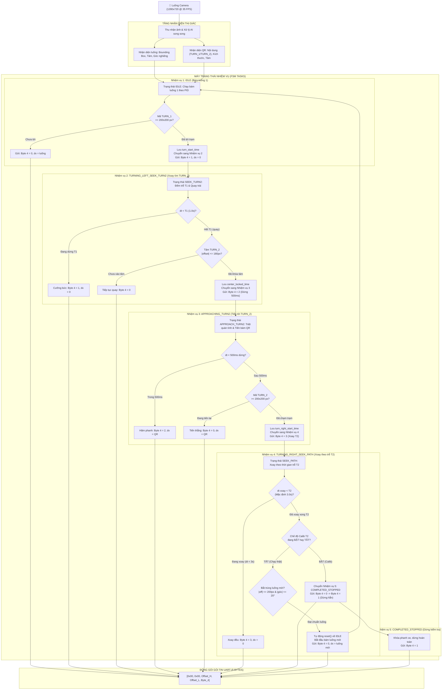

# TÀI LIỆU KIẾN TRÚC PHẦN MỀM & MÔ TẢ CÁC NHIỆM VỤ (TASKS) CỦA ROBOT AGV NÔNG NGHIỆP

---

## 1. TỔNG QUAN HỆ THỐNG PHẦN MỀM (SOFTWARE OVERVIEW)

Hệ thống phần mềm trên máy tính nhúng (Raspberry Pi 5) đóng vai trò là "bộ não thị giác và điều phối cấp cao" (High-level Mission & Vision Controller). Hệ thống vận hành theo vòng lặp thời gian thực (Real-time Vision Loop) từ 30 – 40 FPS, gồm 4 phân tầng chính:

1. **Perception Layer (Tầng Thị giác):**
   * **Path Detection (`src/path_detector.py` / `src/yolo_segmenter.py`):** Phân đoạn ảnh luống bạt (màu đen/xanh) bằng mô hình `YOLO-FastestV2 NCNN INT8`, trích xuất Bounding Box, điểm tâm luống $C_{\text{path}}(x, y)$, đường tim (Centerline) và độ lệch ngang $\text{dx}_{\text{path}} = x_{\text{path}} - x_{\text{cam}}$.
   * **QR Checkpoint & Sizing (`qr_scanner/detector.py`):** Phát hiện, giải mã text (`TURN_1`, `TURN_2`) và đo đạc kích thước thực tế theo pixel $(\text{width} \times \text{height})$, tâm QR $C_{\text{qr}}(x, y)$.

2. **Navigation Fusion Layer (Tầng Hợp nhất Dẫn hướng - `fuse_navigation_target`):**
   * Quyết định mục tiêu lái dựa trên điều kiện kích thước QR:
     * Bình thường: Bám theo tâm luống (`PATH_LINE`).
     * Khi QR đạt kích thước $> 100 \times 100\text{ px}$: Tự động ghi đè sang bám tâm mã QR (`QR_CENTER`).

3. **Mission State Machine Layer (Máy trạng thái Nhiệm vụ - `QRTurnMissionManager`):**
   * Quản lý chu trình chuyển hướng tự động giữa các luống qua 5 nhiệm vụ khép kín.

4. **Communication Layer (Tầng Đóng gói & Truyền thông UART - `uart_controller.py`):**
   * Đóng gói gói tin 5 Bytes gửi xuống vi điều khiển STM32 với tần số theo chu kỳ khung hình (25 – 33ms).

---

## 2. LƯU ĐỒ GIẢI THUẬT CÁC NHIỆM VỤ (MISSION FLOWCHART)

---

## 3. MÔ TẢ CHI TIẾT TỪNG NHIỆM VỤ (TASKS DETAIL)

### 📌 NHIỆM VỤ 1: `IDLE` (Chạy bám luống ban đầu & Canh chạm trạm TURN_1)
* **Ý nghĩa:** Trạng thái xuất phát điểm và chạy thường trực khi robot đang làm việc trên hàng cây.
* **Đầu vào (Inputs):** Khung hình camera, kết quả nhận diện luống `path_res`, danh sách các mã QR `qr_results`.
* **Thuật toán kiểm tra:**
  1. Tính độ lệch tâm luống: $\text{dx} = x_{\text{path\_center}} - x_{\text{cam\_center}}$.
  2. Quét mảng `qr_results` tìm mã thỏa mãn `is_turn1_code(text)`.
  3. Lấy kích thước đường bao lớn nhất: $\text{dim} = \max(\text{width}, \text{height})$.
* **Điều kiện chuyển trạng thái:**
  * Nếu $\text{dim} < 200\text{ px}$ (hoặc chưa thấy QR): Tiếp tục duy trì `IDLE`, gửi gói tin điều khiển PID: `Byte 4 = 0`, `offset = dx`.
  * Nếu $\text{dim} \ge 200\text{ px}$: Xác nhận robot đã chạm vạch dừng trạm `TURN_1`.
    * Ghi nhận: `self.turn_start_time = now`.
    * Reset bộ đếm xác nhận: `self.consecutive_turn2_frames = 0`.
    * Chuyển trạng thái: `self.state = QRTurnMissionState.TURNING_LEFT_SEEK_TURN2`.
    * Gửi gói tin: `Byte 4 = 1`, `offset = 0.0`.

---

### 📌 NHIỆM VỤ 2: `TURNING_LEFT_SEEK_TURN2` (Trễ dừng T1 & Xoay trái khóa tâm TURN_2)
* **Ý nghĩa:** Đảm bảo xe dừng hẳn 1.0 giây tại trạm `TURN_1` để triệt tiêu dao động hình ảnh, sau đó quay góc sang trái để camera quét tìm mã mốc `TURN_2`.
* **Các giai đoạn thực thi:**
  1. **Giai đoạn Đếm trễ ban đầu $T_1$ ($\Delta t < 1.0\text{s}$):**
     * $\Delta t = t_{\text{now}} - \text{turn\_start\_time}$.
     * Trong thời gian này, phần mềm gửi liên tục `Byte 4 = 1`, `offset = 0.0` để STM32 nhận đủ lệnh dừng và ổn định quán tính.
  2. **Giai đoạn Xoay trái quét tìm `TURN_2` ($\Delta t \ge 1.0\text{s}$):**
     * Gửi `Byte 4 = 0` (lệnh quay do vi điều khiển xử lý).
     * Camera tìm mã `TURN_2` (hoặc box AI của QR).
     * Tính độ lệch tâm QR: $\text{offset} = x_{\text{qr\_center}} - x_{\text{cam\_center}}$.
     * Tiêu chí khóa tâm: $|\text{offset}| \le \text{align\_tolerance\_px}$ (mặc định $\le 180\text{ px}$).
* **Cơ chế chống nhiễu (Debounce Confirmation):**
  * Nếu chưa vào tâm ($|\text{offset}| > 180\text{px}$): Đặt lại `consecutive_turn2_frames = 0`, xe tiếp tục quay.
  * Nếu đã vào tâm: Tăng `consecutive_turn2_frames += 1`.
  * Khi đạt đủ `confirm_frames` (mặc định 1 frame):
    * Ghi nhận: `self.center_locked_time = now`.
    * Chuyển trạng thái: `self.state = QRTurnMissionState.APPROACHING_TURN2`.
    * Gửi gói tin: `Byte 4 = 2`, `offset = offset_px`.

---

### 📌 NHIỆM VỤ 3: `APPROACHING_TURN2` (Triệt tiêu quán tính & Tiến thẳng đến đích TURN_2)
* **Ý nghĩa:** Tạm dừng 500ms để hãm quán tính quay của xe, sau đó điều khiển lái tự động tiến thẳng theo tâm mã `TURN_2`.
* **Các giai đoạn thực thi:**
  1. **Giai đoạn Hãm quán tính ($\Delta t_{\text{pause}} < 0.5\text{s}$):**
     * $\Delta t_{\text{pause}} = t_{\text{now}} - \text{center\_locked\_time}$.
     * Gửi `Byte 4 = 2` (STM32 dừng động cơ 500ms).
  2. **Giai đoạn Tiến thẳng bám tâm QR ($\Delta t_{\text{pause}} \ge 0.5\text{s}$):**
     * Gửi `Byte 4 = 0` để xe lăn bánh tới trước.
     * Độ lệch lái bám sát tâm `TURN_2`: $\text{offset} = x_{\text{qr\_center}} - x_{\text{cam\_center}}$.
  3. **Thuật toán Failsafe chống rung lắc:**
     * Nếu xe tăng tốc làm rung lắc hoặc mờ khung hình tạm thời: Phần mềm duy trì độ lệch gần nhất trong vòng 1.2 giây (`time_since_seen <= 1.2s`), ngăn xe bị giật tay lái đột ngột.
* **Điều kiện chuyển trạng thái:**
  * Đo kích thước mã `TURN_2`: $\text{dim} = \max(\text{width}, \text{height})$.
  * Khi $\text{dim} \ge 200\text{ px}$ (Đã chạm đích trạm dừng `TURN_2`):
    * Ghi nhận: `self.turn_right_start_time = now`.
    * Đặt lại bộ đếm luống: `self.consecutive_path_frames = 0`.
    * Chuyển trạng thái: `self.state = QRTurnMissionState.TURNING_RIGHT_SEEK_PATH`.
    * Gửi gói tin: `Byte 4 = 3`, `offset = 0.0`.

---

### 📌 NHIỆM VỤ 4: `TURNING_RIGHT_SEEK_PATH` (Xoay theo thời gian trễ T2 vào luống mới)
* **Ý nghĩa:** Tại mốc `TURN_2`, robot xoay để đưa đầu xe hướng thẳng vào luống đường mới.
* **Các giai đoạn thực thi:**
  * Tính thời gian xoay: $\Delta t_{\text{xoay}} = t_{\text{now}} - \text{turn\_right\_start\_time}$.
  * Trong suốt khoảng thời gian $\Delta t_{\text{xoay}} < T_2$ (mặc định $T_2 = 3.0\text{s}$):
    * **Hoàn toàn bỏ qua nhận diện mặt đường** nhằm chống hiện tượng nhận diện nhầm vệt rác, bóng nắng hay mặt sàn cũ dưới chân trạm.
    * Gửi liên tục: `Byte 4 = 3`, `offset = 0.0`.
  * Khi $\Delta t_{\text{xoay}} \ge T_2$ (Đã xoay đủ 3.0s):
    * **Nhánh 1: Nếu bật "Chế độ Calib T2":**
      * Chuyển sang **Nhiệm vụ 5: `COMPLETED_STOPPED`**.
      * Gửi gói tin: `Byte 4 = 0` (để STM32 ngắt cờ xoay) rồi `Byte 4 = 1` (khóa phanh dừng hẳn).
    * **Nhánh 2: Nếu tắt Calib T2 (Vận hành tự động):**
      * Kích hoạt bộ kiểm tra luống đường mới:
        * Tâm luống trong phạm vi: $|\text{offset}_{\text{path}}| \le 200\text{ px}$.
        * Góc nghiêng luống chuẩn: $|\text{angle}_{\text{path}}| \le 20^\circ$.
      * Khi nhận diện ổn định đủ số frame xác nhận (`confirm_frames`):
        * Gọi `self.reset()` đưa toàn bộ FSM về `IDLE`.
        * Gửi `Byte 4 = 0`, `offset = dx_luống_mới`.
        * Xe tiếp tục chu trình bám luống mới chạy thẳng.

---

### 📌 NHIỆM VỤ 5: `COMPLETED_STOPPED` (Dừng xe cố định phục vụ Calib)
* **Ý nghĩa:** Trạng thái chuyên biệt phục vụ quá trình căn chỉnh cơ khí và kiểm tra thời gian trễ xoay $T_2$.
* **Hành vi:**
  * Xe duy trì dừng hẳn tuyệt đối, khóa phanh (`Byte 4 = 1`, `offset = 0.0`).
  * Cho phép người vận hành quan sát thực tế đầu xe có hướng đúng tim luống mới hay chưa (để tăng/giảm giá trị $T_2$ trên giao diện).
  * Chỉ thoát khỏi trạng thái này khi người dùng bấm nút **🔄 Reset Thủ Công** trên giao diện hoặc tắt chế độ Calib.

---

## 4. QUY CÁCH ĐÓNG GÓI GÓI TIN UART (5 BYTES PROTOCOL)

Gói tin nhị phân truyền từ máy tính nhúng Raspberry Pi 5 xuống vi điều khiển qua cổng `/dev/ttySTM32`:

$$\text{Packet} = [\text{Byte 0}, \text{Byte 1}, \text{Byte 2}, \text{Byte 3}, \text{Byte 4}]$$

| Byte | Tên trường | Kiểu dữ liệu | Mô tả chi tiết |
| :---: | :--- | :---: | :--- |
| **0** | `Header 1` | `uint8` | Byte đồng bộ `0x00` |
| **1** | `Header 2` | `uint8` | Byte đồng bộ `0x00` |
| **2** | `Offset High` | `uint8` | Byte cao của giá trị độ lệch tâm (`float16` / `int16`) |
| **3** | `Offset Low` | `uint8` | Byte thấp của giá trị độ lệch tâm |
| **4** | `Control Flag` | `uint8` | **Cờ điều khiển trạng thái nhiệm vụ:** • `0`: Chạy bình thường theo PID (bám luống hoặc bám tâm QR) • `1`: Dừng hẳn (Trạm dừng `TURN_1` hoặc Calib dừng hoàn tất) • `2`: Tạm dừng 500ms triệt tiêu quán tính quay sau khi khóa tâm `TURN_2` • `3`: Lệnh xoay chuyển hướng tại trạm `TURN_2` |

---

## 5. BẢNG THAM SỐ CẤU HÌNH NHIỆM VỤ TRÊN GIAO DIỆN GUI

| Tên tham số trên GUI | Tên biến trong Code | Giá trị mặc định | Giải thích chức năng |
| :--- | :--- | :---: | :--- |
| **Tâm TURN_2** | `align_tolerance_px` | `180 px` | Vùng sai số cho phép để xác nhận mã `TURN_2` đã vào giữa khung hình |
| **Bắt luống** | `path_seek_tolerance_px`| `200 px` | Độ lệch tâm tối đa cho phép để khóa tim luống mới sau khi xoay |
| **Trễ T1** | `delay_turn1_sec` | `1.00 s` | Thời gian dừng vững tại trạm `TURN_1` trước khi bắt đầu quay trái |
| **Trễ T2** | `delay_turn2_sec` | `3.00 s` | Thời gian robot xoay góc tại trạm `TURN_2` để hướng sang luống mới |
| **Frames** | `confirm_frames` | `1 f` | Số khung hình liên tiếp cần xác nhận để chuyển trạng thái (chống nhiễu) |
| **Chế độ Calib T2** | `calib_turn2_stop_only` | `True / False` | Bật: Xoay xong $T_2$ dừng hẳn để kiểm tra; Tắt: Tự động bám luống chạy tiếp |
| **Trạm dừng (>=px)** | `min_stop_qr_dim` | `200 px` | Kích thước cạnh đường bao QR tối thiểu để kích hoạt trạm dừng |
